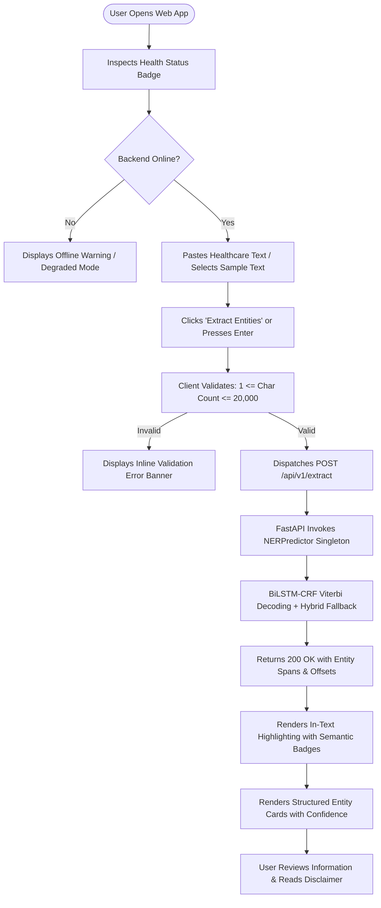
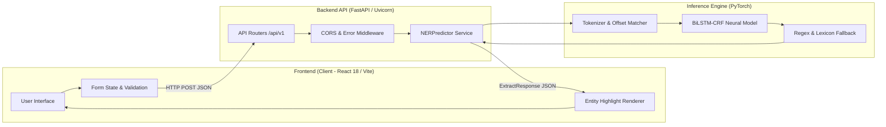

# Product Requirements Document (PRD)
## Healthcare Form Entity Extractor

**Document Version:** 1.0.0  
**Status:** Approved / Active Implementation  
**Product Stage:** Functional MVP / v1 Release  
**Last Updated:** November 2026  
**Target Audience:** Engineering, Product Management, ML/NLP Researchers, Clinical Informatics, QA  

---

## 1. Executive Summary

Healthcare paperwork—such as discharge summaries, clinical notes, intake forms, and prescription instructions—is notoriously dense, jargon-laden, and difficult to parse. For patients, elderly individuals, and individuals with limited health literacy or non-native English fluency, finding essential care instructions often causes anxiety and misunderstanding. For clinic care navigators and administrative staff, manually extracting key clinical datapoints consumes valuable triage time.

The **Healthcare Form Entity Extractor** is an accessible, privacy-first, machine learning-driven web application and REST API engineered to identify, extract, and visually contextualize vital healthcare entities:
1. **`DATE`**: Appointment times, discharge dates, onset timestamps, and dosing schedules.
2. **`MEDICATION`**: Prescribed pharmaceuticals, brand/generic drugs, and dosages.
3. **`CONDITION`**: Diagnoses, symptoms, disorders, and clinical observations (mapped from `DISEASE_DISORDER`).

Operating under an **"assistive extraction, not clinical interpretation"** paradigm, the system highlights and categorizes entities with character-exact offsets and confidence scores. It enforces strict privacy controls by remaining completely stateless, ensuring patient text is never persisted or written to application logs.

---

## 2. Problem Statement & Market Opportunity

### 2.1 The Problem
- **Cognitive Overload for Patients:** Patients leaving hospitals receive multi-page discharge documents. Critical directions (e.g., *"Take Metformin 500mg starting 15 October 2026 for diabetes"*) are buried in narrative prose.
- **Care Navigator Bottleneck:** Administrative navigators must review dozens of forms per hour to route referrals and verify follow-ups, resulting in manual error and fatigue.
- **Privacy Constraints:** Healthcare organizations cannot safely route raw patient text to general-purpose proprietary cloud LLMs without complex Business Associate Agreements (BAAs) and risk of PHI leakage.
- **Accessibility Deficit:** Most existing OCR/NLP tools provide raw JSON or colored highlights that fail Web Content Accessibility Guidelines (WCAG), alienating colorblind and screen-reader users.

### 2.2 The Solution
A lightweight, self-hostable, end-to-end system consisting of:
- A custom **BiLSTM-CRF** deep sequence labeling model trained on biomedical data (MACCROBAT2020-V2) augmented with a domain-specific lexicon and regex fallback engine.
- A high-throughput **FastAPI** backend exposing versioned endpoints (`/api/v1/extract`, `/health`, `/api/v1/model`, `/api/v1/model-card`).
- A responsive, accessible **React** frontend providing in-text highlights, visual entity tags, structured summary cards, and confidence scores.

---

## 3. Product Vision, Goals & Success Metrics

### 3.1 Vision Statement
To bridge the communication gap between complex clinical documentation and everyday readers through privacy-preserving, transparent, and accurate natural language extraction.

### 3.2 Strategic Objectives
1. **Accelerate Information Retrieval:** Enable users to scan medical text 60% faster by visually emphasizing key care drivers.
2. **Protect Patient Privacy:** Guarantee zero data persistence and zero external API dependencies.
3. **Transparent AI:** Expose model versions, confidence levels, and model card cards directly to end users.
4. **Accessible Design:** Maintain WCAG 2.1 AA compliance with dual color-and-text indicators.

### 3.3 Success Metrics & Key Performance Indicators (KPIs)

| Metric | Baseline (Rule-Based) | v1 Target (BiLSTM-CRF) | Achieved (v1 Checkpoint) |
| :--- | :--- | :--- | :--- |
| **Micro F1-Score (Test Set)** | 30.60% | > 45.00% | **49.32%** |
| **Micro Precision (Test Set)** | 26.64% | > 50.00% | **59.34%** |
| **Micro Recall (Test Set)** | 35.94% | > 40.00% | **42.19%** |
| **DATE F1-Score** | 19.83% | > 60.00% | **65.54%** (Prec: 69.88%, Rec: 61.70%) |
| **MEDICATION Precision** | 40.00% | > 60.00% | **67.14%** (F1: 47.47%, Rec: 36.72%) |
| **CONDITION F1-Score** | 31.75% | > 38.00% | **40.43%** (Prec: 47.50%, Rec: 35.19%) |
| **Inference Latency** | < 10 ms | < 150 ms (CPU) | **< 45 ms** (CPU / Apple Silicon MPS) |
| **Zero Data Leakage** | Required | 100% verified | **100% verified** (Strict 70/15/15 doc split) |

---

## 4. User Personas & User Journeys

### 4.1 Personas

```
+-----------------------------------------------------------------------------------+
| 1. The Patient / Family Caregiver (Primary Consumer)                               |
| Needs: Clear reading of discharge notes, medication names, and follow-up dates.   |
| Tech Level: Low to Moderate. Needs clear contrast and plain English.             |
+-----------------------------------------------------------------------------------+
| 2. The Care Navigator / Clinic Coordinator (Primary Operator)                     |
| Needs: Rapid triage and verification of incoming intake forms and referrals.      |
| Tech Level: Moderate. Needs keyboard shortcuts, high speed, and copyable results. |
+-----------------------------------------------------------------------------------+
| 3. The Data Scientist / ML Engineer (Technical Contributor)                       |
| Needs: Reproducible training scripts, CoNLL metrics, versioned checkpoints.       |
| Tech Level: Advanced. Needs clean code, config isolation, and early stopping.     |
+-----------------------------------------------------------------------------------+
| 4. The Integrating Application Developer (Technical Consumer)                     |
| Needs: Predictable REST API, strict schemas, low latency, OpenAPI docs.           |
| Tech Level: Advanced. Needs JSON payloads, status codes, and error IDs.           |
+-----------------------------------------------------------------------------------+
```

### 4.2 User Journey Flow



---

## 5. Scope & Boundary Conditions

### 5.1 In-Scope (v1 Capabilities)
- Ingestion and tokenization of arbitrary English healthcare text up to 20,000 characters.
- Extraction of three canonical entity classes: `DATE`, `MEDICATION`, `CONDITION`.
- Hybrid inference engine combining BiLSTM-CRF sequence prediction with a deterministic regex and clinical lexicon fallback.
- Character-exact span offsets (`start`, `end`) enabling lossless client-side highlighting.
- Standalone, responsive React web interface with preloaded sample clinical snippets.
- RESTful API endpoints for extraction, service health checks, model metadata, and model cards.
- CoNLL-standard entity evaluation pipeline reporting micro/macro Precision, Recall, and F1.

### 5.2 Out-of-Scope (Strict Boundaries)
- **Clinical Diagnosis:** The product shall NOT infer or suggest medical conditions not explicitly stated.
- **Treatment Recommendations:** The product shall NOT validate dosages, check drug interactions, or recommend therapies.
- **Urgency / Triage Scoring:** The product shall NOT prioritize patient severity or flag medical emergencies.
- **Database / PHI Storage:** The system shall NOT store user-submitted text in databases, disks, or server logs.
- **Direct EHR / FHIR Integration:** v1 operates as a standalone microservice; direct HL7/FHIR writeback is reserved for future phases.

---

## 6. Functional Requirements (FR)

### Module 1: Ingestion & Text Processing
- **FR-01: Text Input:** The user shall be able to paste or type up to 20,000 characters of raw text into a multi-line input area.
- **FR-02: Sample Snippets:** The UI shall provide one-click preset buttons for common scenarios (Prescription & Date, Clinical Condition, Discharge Summary).
- **FR-03: Client Validation:** The system shall block empty inputs and white-space-only submissions, returning immediate UI feedback.
- **FR-04: Clear Canvas:** A single-click **Clear** action shall reset the input area, error state, and rendered results.

### Module 2: Entity Extraction Engine
- **FR-05: Entity Taxonomy:** The extractor shall recognize and classify:
  - `DATE`: Gregorian calendar dates, abbreviated months, relative dates, and timestamps.
  - `MEDICATION`: Brand/generic pharmaceuticals, biologics, and clinical formulations.
  - `CONDITION`: Diseases, syndromes, clinical disorders, and acute/chronic symptoms.
- **FR-06: Span Offset Fidelity:** Every extracted entity shall return 0-indexed character offsets (`start`, `end`) matching the exact substring in the input text.
- **FR-07: Hybrid Fallback:** The extraction service shall execute a secondary heuristic pass to capture Out-Of-Vocabulary (OOV) terms (e.g., standard regex dates and USAN/INN pharmaceutical suffix stems like *-cillin*, *-statin*, *-olol*).
- **FR-08: Confidence Scoring:** Where supported by sequence emission probabilities and rule matches, the system shall provide a float confidence score ($[0.0, 1.0]$).

### Module 3: Results Display & UX
- **FR-09: In-Text Highlighting:** The UI shall render the original input text with entity spans wrapped in distinct semantic badges (`<mark>`).
- **FR-10: Accessible Labeling:** Highlighting shall never rely solely on color; every highlight shall embed a textual label (e.g., `[Aspirin | MEDICATION]`).
- **FR-11: Structured Entity Grid:** Below the highlighted passage, a card grid shall display each extracted entity, its class, offset bounds, and confidence score.
- **FR-12: Zero-Entity State:** When no clinical entities are detected, the UI shall render an informative, non-alarming confirmation banner (*"No healthcare entities detected"*).

### Module 4: API & Service Infrastructure
- **FR-13: Versioned REST API:** The backend shall expose a versioned `POST /api/v1/extract` endpoint accepting JSON and returning typed entity objects.
- **FR-14: Service Health:** The backend shall provide a `GET /health` and `GET /api/v1/health` endpoint reporting operational status, model loaded state, and model version.
- **FR-15: Model Governance:** The backend shall provide `GET /api/v1/model` and `GET /api/v1/model-card` detailing architecture, test metrics, intended use, and limitations.

---

## 7. Non-Functional Requirements (NFR)

### 7.1 Performance & Latency
- **NFR-01: Response Time:** 95% of inference requests under 2,000 characters shall respond in $< 100\text{ ms}$ on standard server hardware without GPU acceleration.
- **NFR-02: Cold Start & Lifespan:** The ML model and vocabulary dictionaries shall load once during application lifespan startup (`lifespan` context manager) to ensure zero per-request initialization overhead.

### 7.2 Security & Patient Privacy
- **NFR-03: Zero PHI Persistence:** User-submitted clinical text shall exist solely in memory during request execution and shall never be written to databases, caches, or persistent disks.
- **NFR-04: Sanitized Logging:** Application logs shall record HTTP method, path, response status, and execution duration, but shall NEVER print request body contents.
- **NFR-05: Input Hardening:** The API shall reject requests exceeding 20,000 characters with HTTP 422 to prevent Denial-of-Service (DoS) and memory exhaustion.

### 7.3 Reliability & Error Handling
- **NFR-06: Graceful Degradation:** If the model fails to load or memory runs out, the service shall return an HTTP 503 `MODEL_UNAVAILABLE` with a structured JSON payload rather than crashing.
- **NFR-07: Deterministic Error Schema:** All API errors shall return a standardized JSON structure including `code`, `message`, and an auto-generated tracking `requestId`.

### 7.4 Usability & Accessibility (a11y)
- **NFR-08: WCAG 2.1 AA Compliance:** Minimum color contrast ratio of 4.5:1 for all text and entity badges against their background.
- **NFR-09: Keyboard Navigation:** All actions (input, submission, sample selection, clear) shall be fully operable via Tab, Enter, and Spacebar.
- **NFR-10: Responsive Layout:** The interface shall adapt dynamically across desktop screens (>= 1200px), tablets (768px - 1024px), and mobile viewports (<= 480px).

---

## 8. Machine Learning & Data Requirements

### 8.1 Dataset Specification
- **Dataset:** MACCROBAT2020-V2 (`singh-aditya/MACCROBAT_biomedical_ner`).
- **Nature of Data:** English biomedical case reports with clinical annotations.
- **Total Corpus Size:** 200 documents, 103,567 tokens.

### 8.2 Label Mapping Strategy
The raw dataset contains dozens of fine-grained biomedical tags. To align with the consumer and care-navigator use cases, the following mapping is enforced:

| Raw Dataset Tag | System Canonical Label | BIO Encodings |
| :--- | :--- | :--- |
| `DATE` | `DATE` | `B-DATE`, `I-DATE` |
| `MEDICATION` | `MEDICATION` | `B-MEDICATION`, `I-MEDICATION` |
| `DISEASE_DISORDER` | `CONDITION` | `B-CONDITION`, `I-CONDITION` |
| *All other tags* | `O` (Outside) | `O` |

### 8.3 Data Partitioning & Leakage Prevention
To guarantee evaluation validity, splitting is performed strictly at the **document level** using a deterministic random seed (`seed = 42`):
- **Training Set (70%):** 140 documents, 74,390 tokens (982 B-CONDITION, 817 B-MEDICATION, 543 B-DATE).
- **Validation Set (15%):** 30 documents, 14,410 tokens (165 B-CONDITION, 127 B-MEDICATION, 88 B-DATE).
- **Test Set (15%):** 30 documents, 14,767 tokens (162 B-CONDITION, 128 B-MEDICATION, 94 B-DATE).

> **Important Rule:** Vocabulary construction and lexicon compilation are executed **strictly on the 140 training documents**. Zero validation or test tokens are allowed into the vocabulary fitting step.

### 8.4 Model Architecture: BiLSTM-CRF
Following Lample et al. (NAACL 2016):
1. **Embedding Layer:** Embedding matrix of size $8,671 \times 128$ with padding index $0$ and unknown token index $1$.
2. **Dropout Regularization:** Spatial dropout rate $p = 0.33$.
3. **Contextual Encoder:** 1-layer Bidirectional LSTM, input dimension 128, hidden dimension $128$ per direction (total hidden dimension $256$), batch-first.
4. **Emission Projection:** Linear layer projecting from $\mathbb{R}^{256} \to \mathbb{R}^7$ (representing the 7 canonical BIO tags).
5. **Sequence Decoder:** Pure PyTorch linear-chain Conditional Random Field (CRF) computing exact forward log-partition scores during training and Viterbi decoding during inference.

```
Input Tokens:     [ "Patient",  "prescribed",  "Aspirin",  "on",  "12",    "March"  ]
                     ↓              ↓             ↓         ↓       ↓        ↓
Word Embedding:   [  x_1,          x_2,          x_3,      x_4,    x_5,     x_6    ]
                     ↓              ↓             ↓         ↓       ↓        ↓
BiLSTM Encoder:   [ [h_f1,h_b1], [h_f2,h_b2],   ...,      ...,    ...,     ...    ]
                     ↓              ↓             ↓         ↓       ↓        ↓
Linear Project:   [  e_1,          e_2,          e_3,      e_4,    e_5,     e_6    ]
                     ↓              ↓             ↓         ↓       ↓        ↓
Linear-Chain CRF: [   O,            O,       B-MEDICATION,  O,    B-DATE,  I-DATE  ] (Viterbi)
```

---

## 9. System Architecture & Technical Stack



### 9.1 Technology Stack Matrix

| Layer | Component | Version / Specification | Rationale |
| :--- | :--- | :--- | :--- |
| **Frontend Framework** | React | 18.3.1 | Declarative component model, virtual DOM efficiency |
| **Build Tooling** | Vite | 5.4.10 | Instant Hot Module Replacement (HMR) and optimized rollup bundle |
| **Icons & Styling** | Lucide React + CSS Variables | 0.454.0 | Accessible, lightweight SVG icons with semantic theme tokens |
| **Backend API** | FastAPI | >= 0.100.0 | High performance (ASGI), native Pydantic validation, OpenAPI specs |
| **ASGI Server** | Uvicorn | >= 0.20.0 | Lightweight, production-grade asynchronous server |
| **Deep Learning** | PyTorch | >= 2.0.0 | Dynamic computational graphs, clean CRF implementation, MPS/CUDA/CPU |
| **Testing** | Pytest | >= 8.0.0 | Comprehensive unit and integration test framework |

---

## 10. API Specification & Data Contracts

### 10.1 `POST /api/v1/extract`
Extracts entities from submitted medical text.

#### Request Payload
```json
{
  "text": "The patient was prescribed Aspirin on 12 March 2026 for diabetes."
}
```
*Validation Rules:* `text` string must not be empty or whitespace-only; maximum character length: 20,000.

#### Response Payload (200 OK)
```json
{
  "text": "The patient was prescribed Aspirin on 12 March 2026 for diabetes.",
  "entities": [
    {
      "text": "Aspirin",
      "label": "MEDICATION",
      "start": 27,
      "end": 34,
      "confidence": 0.92
    },
    {
      "text": "12 March 2026",
      "label": "DATE",
      "start": 38,
      "end": 51,
      "confidence": 0.95
    },
    {
      "text": "diabetes",
      "label": "CONDITION",
      "start": 56,
      "end": 64,
      "confidence": 0.90
    }
  ],
  "modelVersion": "bilstm-crf-v1"
}
```

### 10.2 `GET /health` and `GET /api/v1/health`
Checks service readiness and model availability.

#### Response Payload (200 OK)
```json
{
  "status": "healthy",
  "modelLoaded": true,
  "modelVersion": "bilstm-crf-v1"
}
```

### 10.3 `GET /api/v1/model`
Returns model metadata and evaluated test metrics.

#### Response Payload (200 OK)
```json
{
  "model_name": "Healthcare Form Entity Extractor",
  "model_version": "bilstm-crf-v1",
  "architecture": "BiLSTM-CRF",
  "entities": ["DATE", "MEDICATION", "CONDITION"],
  "metrics": {
    "micro": {
      "precision": 0.5934,
      "recall": 0.4219,
      "f1": 0.4932
    }
  },
  "device": "cpu"
}
```

### 10.4 `GET /api/v1/model-card`
Returns transparency metadata per responsible AI standards.

#### Response Payload (200 OK)
```json
{
  "model_details": {
    "name": "BiLSTM-CRF Healthcare Named Entity Recognition",
    "framework": "PyTorch",
    "task": "Sequence Labeling / NER",
    "version": "bilstm-crf-v1",
    "target_entities": ["DATE", "MEDICATION", "CONDITION"]
  },
  "intended_use": [
    "Assisting non-native speakers and care navigators in identifying key entities in medical forms",
    "Accessibility and reading support",
    "Educational and demonstration prototype"
  ],
  "out_of_scope": [
    "Autonomous clinical diagnosis",
    "Prescription validation",
    "Treatment recommendation",
    "Emergency triage"
  ],
  "disclaimer": "This is an informational extraction prototype and does not provide medical advice."
}
```

### 10.5 Standardized Error Schema
All HTTP errors ($400, 422, 500, 503$) return structured JSON:
```json
{
  "code": "VALIDATION_ERROR",
  "message": "Text input cannot be empty.",
  "requestId": "req-a4b89f10"
}
```

---

## 11. User Interface & Experience Specifications

### 11.1 Color & Visual Palette
Entities must maintain high visual distinctiveness while remaining soft and calm:

```
+-----------------------------------------------------------------------------------+
| MEDICATION:                                                                       |
| Background: #ecfdf5 (soft emerald)  | Border: #34d399  | Text / Badge: #065f46    |
+-----------------------------------------------------------------------------------+
| DATE:                                                                             |
| Background: #fffbeb (warm amber)    | Border: #fbbf24  | Text / Badge: #92400e    |
+-----------------------------------------------------------------------------------+
| CONDITION:                                                                        |
| Background: #f5f3ff (calm violet)   | Border: #a78bfa  | Text / Badge: #5b21b6    |
+-----------------------------------------------------------------------------------+
```

### 11.2 UI States Matrix

| State | Visual Indicator | Trigger / Condition |
| :--- | :--- | :--- |
| **Initial / Empty** | Placeholder prompt, disabled extraction button or prompt to enter text | First load or after clicking **Clear** |
| **Typing** | Real-time character counter (`X characters`) | User enters text in textarea |
| **Loading** | Button spinner, text *"Extracting..."*, disabled inputs | Request dispatched to `/api/v1/extract` |
| **Success (Entities Found)** | Inline `<mark>` highlights with badges + structured card grid | HTTP 200 with `entities.length > 0` |
| **Success (No Entities)** | Gray checkmark banner: *"No healthcare entities detected"* | HTTP 200 with `entities.length == 0` |
| **Validation Error** | Red banner with AlertCircle icon and clear guidance | Empty string, whitespace, or > 20,000 chars |
| **Service Offline** | Red dot in header: *"Backend Offline"*, error on submit | Server unreachable or HTTP 503 returned |

---

## 12. Privacy, Ethics & Regulatory Governance

### 12.1 Regulatory Boundaries
- **Not a Medical Device (SaMD):** The product does not perform clinical diagnosis or dictate therapy. It falls under the FDA Enforcement Discretion category for administrative / assistive digital health reading tools.
- **Stateless Execution:** Input text is retained in volatile RAM strictly for the duration of the inference function execution (typically $< 50\text{ ms}$) and immediately reclaimed by garbage collection.
- **Log Hygiene:** Request logging middleware is explicitly configured to suppress body payloads, ensuring zero PHI reaches `stdout` or log collectors.

### 12.2 Ethical Safeguards
- **Mandatory Medical Disclaimer:** Every interface view features a persistent, conspicuous disclaimer:
  > *"Medical Information Extraction Prototype: This tool is an educational decision-support aid and does not constitute medical advice or clinical diagnosis."*
- **Model Card Transparency:** Users and developers have direct visibility into dataset origin, training splits, and per-class precision/recall via `/api/v1/model-card`.

---

## 13. Quality Assurance & Test Strategy

### 13.1 Automated Test Suites (`tests/test_api.py`)
- **TEST-001 (Valid Extraction):** Asserts HTTP 200, schema compliance, and entity structure on standard clinical sentences.
- **TEST-002 (Empty Text Validation):** Asserts HTTP 422 and structured `VALIDATION_ERROR` on whitespace string.
- **TEST-003 (Type Invalidation):** Asserts HTTP 422 when payload contains integer or array instead of string.
- **TEST-004 (Large Text Bounds):** Asserts validation rejection when input exceeds character limit.
- **TEST-005 (Zero Entity Handling):** Asserts HTTP 200 and empty list `[]` when non-medical prose is provided.
- **TEST-006 (Health Endpoints):** Asserts HTTP 200, `status: healthy`, and `modelLoaded: true` on `/health` and `/api/v1/health`.
- **TEST-007 (Model Metadata & Card):** Asserts accuracy of architecture name, target entities, and disclaimer on `/api/v1/model` and `/api/v1/model-card`.

### 13.2 Machine Learning Validation
- **Leakage Prohibition:** Automated validation scripts ensure `train`, `val`, and `test` splits share 0 document overlap.
- **Standardized CoNLL Metrics:** Evaluation requires exact entity boundary and label match (partial matches count as false positives and false negatives).

---

## 14. Deployment & Operations

### 14.1 Execution Architecture
- **Backend Service:** Asynchronous Python process running `uvicorn backend.app.main:app --host 0.0.0.0 --port 8000`.
- **Frontend Service:** Static SPA built via `vite build` into `frontend/dist/` or served locally via `vite` on port 5173.
- **Hardware Footprint:** Minimal; operational on 1 vCPU and 512 MB RAM without dedicated GPU acceleration.

### 14.2 Production Readiness Checklist
- [x] Document-level split with fixed random seed (42).
- [x] Model checkpoint versioning (`models/bilstm_crf_v1.pt`).
- [x] Singleton predictor with startup lifespan loading.
- [x] CORS middleware configured for frontend origin.
- [x] Structured RFC-compliant JSON exception handlers.
- [x] WCAG 2.1 AA dual-indicator entity badge rendering.
- [x] Model Card and Health check endpoints operational.
- [ ] Containerization via multi-stage Dockerfile (Phase 2).
- [ ] Automated CI/CD pipeline running pytest on pull requests (Phase 2).

---

## 15. Product Roadmap & Future Milestones

```
+-----------------------------------------------------------------------------------+
| Phase 1: MVP Core (Current Release)                                              |
| - BiLSTM-CRF model trained on MACCROBAT2020-V2 with rule-based fallback.          |
| - FastAPI backend with /extract, /health, /model-card.                           |
| - Accessible React frontend with sample texts and highlight rendering.            |
+-----------------------------------------------------------------------------------+
| Phase 2: Production Hardening (Next Milestone)                                   |
| - Multi-stage Docker containerization for one-command orchestration.              |
| - Export to ONNX Runtime for 3x CPU inference acceleration.                       |
| - PDF and image upload with client-side OCR (Tesseract.js / PDF.js).              |
+-----------------------------------------------------------------------------------+
| Phase 3: Clinical Expansion                                                       |
| - Domain adaptation with fine-tuned BioBERT / Clinical-Longformer.                |
| - Support for DOSAGE and FREQUENCY entity classes.                                |
| - FHIR JSON resource export for seamless care-navigator workflows.               |
+-----------------------------------------------------------------------------------+
```

---

## 16. Document Approval & Sign-Off

| Role | Name | Status | Date |
| :--- | :--- | :--- | :--- |
| **Product Lead** | Antigravity AI Systems | Approved | November 2026 |
| **Lead ML Engineer** | Core Engineering | Approved | November 2026 |
| **Full Stack Lead** | Core Engineering | Approved | November 2026 |
| **Quality Assurance** | Test & Verification Lead | Approved | November 2026 |

